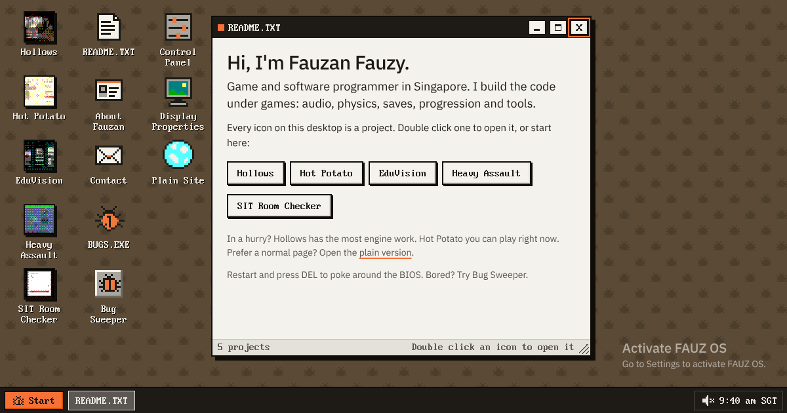
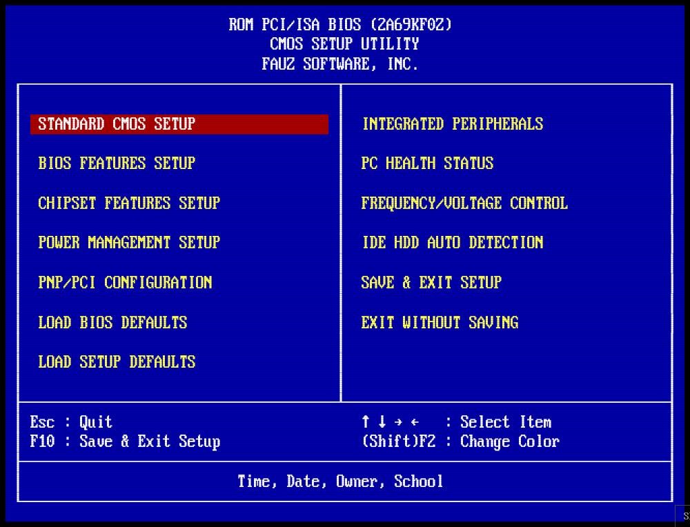

# Fauzan Fauzy's portfolio

**Live site: [qayzan.github.io/portfolio](https://qayzan.github.io/portfolio/)**

My portfolio is a small pretend computer. Switch it on, watch it run its power on self test, press DEL for the BIOS, then open my projects as programs on the desktop.

I'm a third year Computer Science (Real-Time Interactive Simulation) student at DigiPen Singapore and SIT, interested in game programming, engine systems and tools work. Prefer a normal page? There is a [plain version](https://qayzan.github.io/portfolio/classic.html).

## What's inside

- **Projects:** Hollows (C++20 engine, audio and physics), Hot Potato (multiplayer browser game), EduVision (Unity Android app), Heavy Assault (C and C++ boss fights) and SIT Room Checker (Python automation).
- **Start up:** a text mode POST and BIOS Setup that work with the keyboard, mouse or touch. Every sound is synthesised with the Web Audio API.
- **Desktop:** draggable and resizable windows, a Start menu, Display Properties with wallpapers and screen savers, Bug Sweeper, and a small joke if you try to activate it.

## How it's built

Hand written HTML, CSS and JavaScript. No framework, no build step, no tracking.

- `index.html`, `js/os.js`, `css/os.css`: FAUZ OS
- `js/data.js`: all project text, shared by both versions
- `js/sig.js`: the pixel name that bugs eat
- `classic.html`, `js/main.js`, `js/hero.js`, `css/style.css`: the plain version

Shortcuts: [`#desktop`](https://qayzan.github.io/portfolio/#desktop) skips straight to the desktop, [`#bios`](https://qayzan.github.io/portfolio/#bios) starts in BIOS Setup.

To run it locally, run `python -m http.server` in this folder and open http://localhost:8000.

## Credits

- Text mode font: IBM VGA 8x16 from [The Ultimate Oldschool PC Font Pack](https://int10h.org/oldschool-pc-fonts/) by VileR, [CC BY-SA 4.0](https://creativecommons.org/licenses/by-sa/4.0/), used unmodified (licence in `assets/fonts/`).
- Reading fonts: IBM Plex Sans and IBM Plex Mono, SIL Open Font License.
- Team projects are shown with credit to my teammates; see each project window for who did what.
- The BIOS, its vendor and its logo are made up.

## Contact

Email [fauzan0410@gmail.com](mailto:fauzan0410@gmail.com), or find me on [LinkedIn](https://www.linkedin.com/in/fauz/) and [GitHub](https://github.com/Qayzan).
